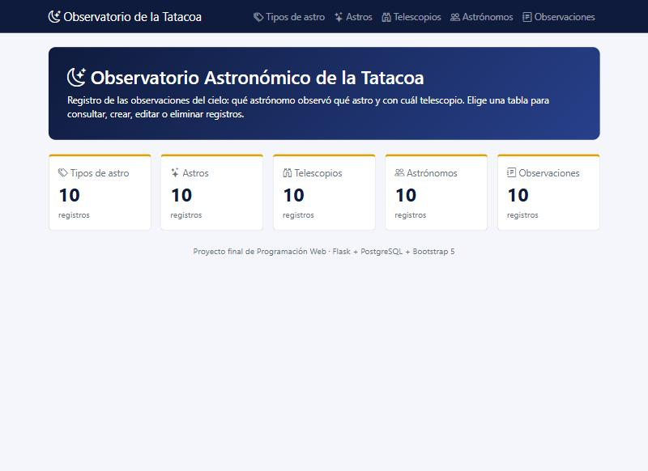
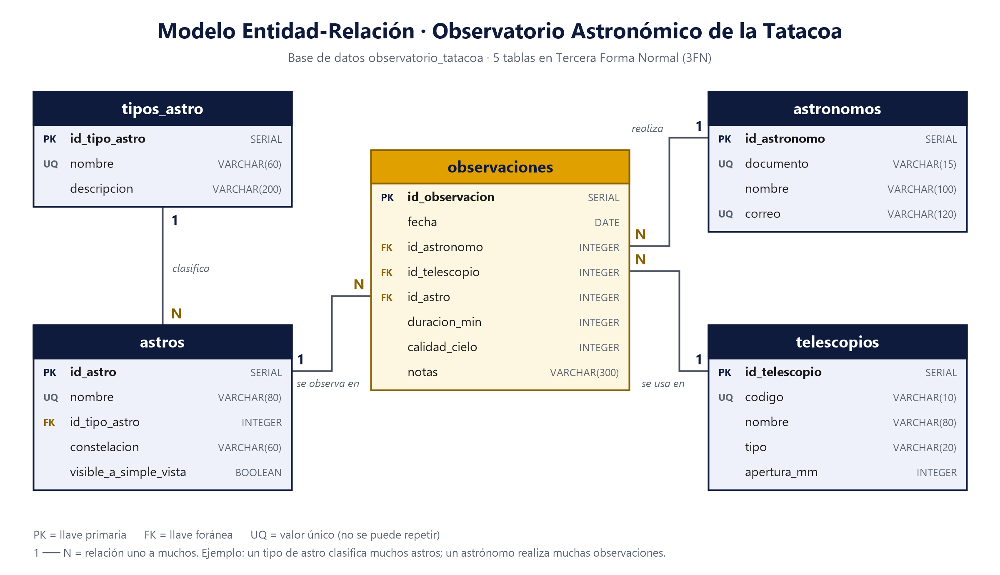
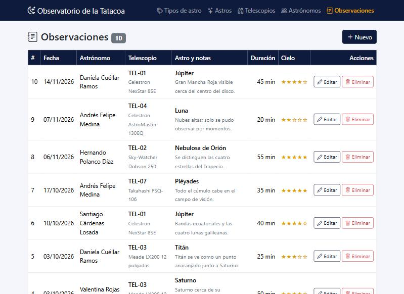
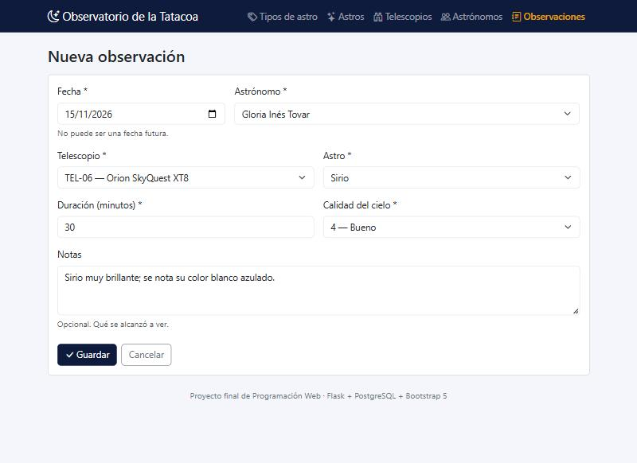
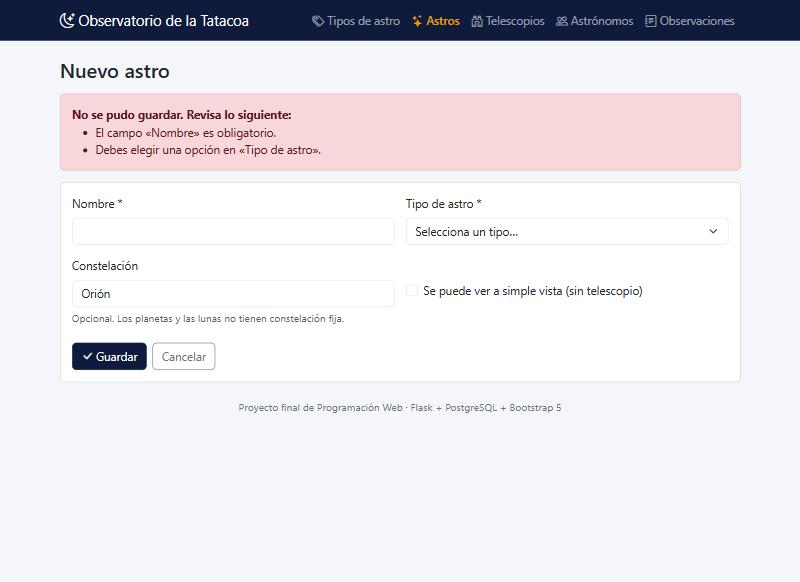
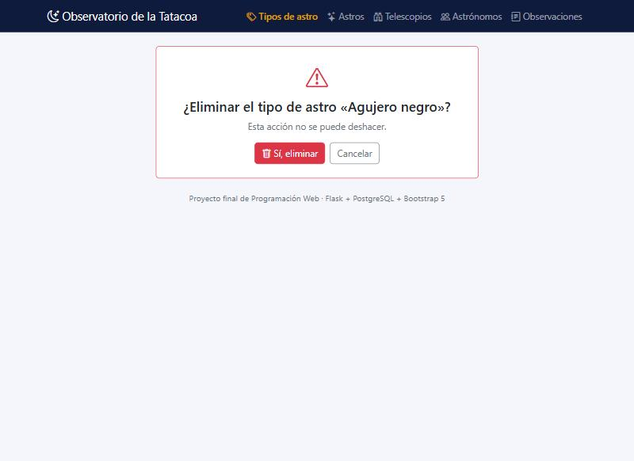
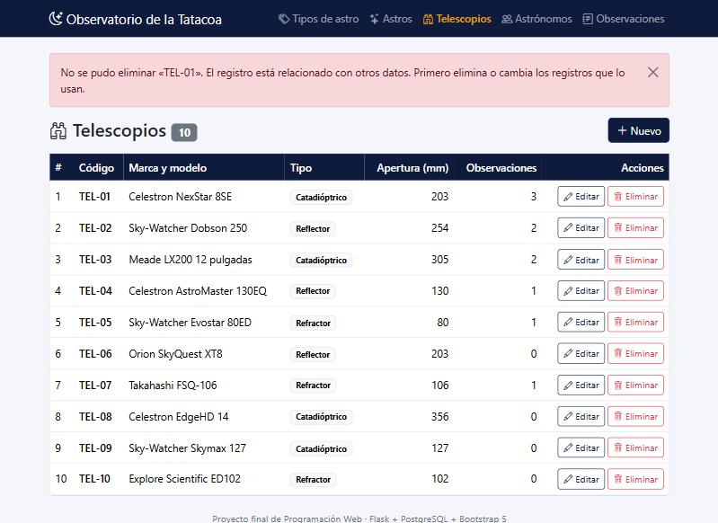

# Observatorio Astronómico de la Tatacoa

Proyecto final de Programación Web: una aplicación web con **Flask** y **PostgreSQL** que lleva el registro de las observaciones del cielo de un observatorio.

La idea completa cabe en una frase:

> **Un astrónomo observa un astro con un telescopio.**



## Contenido

1. [Integrantes](#integrantes)
2. [Descripción del tema](#descripción-del-tema)
3. [Modelo Entidad-Relación](#modelo-entidad-relación)
4. [Tecnologías](#tecnologías)
5. [Instalación y ejecución](#instalación-y-ejecución)
6. [Capturas de la aplicación](#capturas-de-la-aplicación)
7. [Pruebas](#pruebas)
8. [Estructura del proyecto](#estructura-del-proyecto)
9. [Cómo se cumple cada requisito técnico](#cómo-se-cumple-cada-requisito-técnico)

## Integrantes

| Nombre | Código |
|---|---|
| Alejandro Solano | 20242226506 |
| Juan Camilo Álvarez | 20242229312 |
| Juan Manuel Salazar | 20242227070 |

## Descripción del tema

El Desierto de la Tatacoa (Huila) tiene uno de los mejores cielos de Colombia para la astronomía. Este proyecto imagina el sistema de un observatorio de la zona, que necesita llevar el control de:

| Tabla | Qué guarda | Ejemplos |
|---|---|---|
| `tipos_astro` | Las categorías de astros | Planeta, Estrella, Galaxia |
| `astros` | Lo que se observa en el cielo | Júpiter, Sirio, Nebulosa de Orión |
| `telescopios` | Los equipos del observatorio | TEL-01, Celestron NexStar 8SE |
| `astronomos` | Las personas que observan | Documento, nombre y correo |
| `observaciones` | Cada observación realizada | Quién, con qué telescopio, qué astro, cuándo y cómo estaba el cielo |

La aplicación permite **listar, crear, editar y eliminar** registros en las 5 tablas.

## Modelo Entidad-Relación

Cinco tablas en Tercera Forma Normal. La tabla `observaciones` tiene **tres llaves foráneas**.



Documentos del modelo, en la carpeta [`docs/`](docs):

- [Diagrama MER](docs/01_mer.png) (también en [SVG](docs/01_mer.svg))
- [Justificación de la normalización](docs/02_normalizacion.md)
- [Diccionario de datos](docs/03_diccionario_de_datos.md)
- [Plan de pruebas con evidencias](docs/04_plan_de_pruebas.md)

## Tecnologías

Python 3 · Flask · PostgreSQL · psycopg2 · HTML5 · Jinja2 · Bootstrap 5 · pytest · Git y GitHub

## Instalación y ejecución

### Requisitos

Se necesita tener instalado:

- **Python 3.10 o superior** — <https://www.python.org/downloads/>
- **PostgreSQL** (con pgAdmin 4) — <https://www.postgresql.org/download/>
- **Git** — <https://git-scm.com/downloads>

### Paso 1. Descargar el proyecto

```
git clone https://github.com/Petrodolar256/observatorio_tatacoa.git
cd observatorio_tatacoa
```

### Paso 2. Crear el entorno virtual e instalar las librerías

En **Windows** (PowerShell):

```
python -m venv .venv
.venv\Scripts\activate
pip install -r requirements.txt
```

En **macOS o Linux**:

```
python3 -m venv .venv
source .venv/bin/activate
pip install -r requirements.txt
```

> Si PowerShell dice que «la ejecución de scripts está deshabilitada», ejecuta primero
> `Set-ExecutionPolicy -Scope Process -ExecutionPolicy Bypass` y repite el comando de activar.
> Ese permiso vale solo para esa ventana.

### Paso 3. Configurar la conexión a la base de datos

Copia la plantilla `.env.example` con el nombre `.env`.

En **Windows**:

```
copy .env.example .env
```

En **macOS o Linux**:

```
cp .env.example .env
```

Abre el archivo `.env` y cambia `DB_PASSWORD` por la contraseña de tu PostgreSQL. Si tu PostgreSQL usa otro puerto o usuario, cambia también `DB_PORT` o `DB_USER`. El archivo `.env` no se sube a GitHub.

### Paso 4. Crear la base de datos

Con PostgreSQL encendido, un solo comando crea la base, las 5 tablas y carga 10 registros en cada una:

```
python crear_base_de_datos.py
```

Otra forma es restaurar el respaldo con `psql`:

```
psql -U postgres -c "CREATE DATABASE observatorio_tatacoa"
psql -U postgres -d observatorio_tatacoa -f database/backup.sql
```

> Si Windows no reconoce `psql`, escribe su ruta completa. En PowerShell lleva un `&` adelante:
>
> `& "C:\Program Files\PostgreSQL\18\bin\psql.exe" -U postgres -d observatorio_tatacoa -f database/backup.sql`
>
> El respaldo se generó con PostgreSQL 18 y se restaura con `psql`. Con una versión anterior, o desde
> pgAdmin, usa la primera forma (`python crear_base_de_datos.py`), que funciona en cualquier versión.

### Paso 5. Iniciar la aplicación

```
python app.py
```

Abre en el navegador: **<http://127.0.0.1:5001>**

Para detenerla, presiona `Ctrl + C` en la terminal.

### Problemas frecuentes

- Si la página dice **«No se pudo conectar a PostgreSQL»**, ahí mismo aparece la lista de lo que hay que revisar: que el servidor esté encendido, el archivo `.env` y que la base de datos exista.
- Para comprobar en segundos que las 5 tablas funcionan, ejecuta las pruebas automáticas (ver [Pruebas](#pruebas)).

## Capturas de la aplicación

**Listado de observaciones.** Muestra los nombres del astrónomo, del telescopio y del astro, no sus números de id.



**Formulario de una observación.** Las tres llaves foráneas se eligen en listas desplegables.



**Validación en el servidor.** Los errores se explican con mensajes claros y no se pierde lo que el usuario escribió.



**Confirmación antes de eliminar.**



**Protección de los datos relacionados.** Un telescopio con observaciones no se deja eliminar, y la aplicación no falla.



## Pruebas

- **Plan de pruebas funcionales:** 35 casos, cada uno con su captura de pantalla, en [`docs/04_plan_de_pruebas.md`](docs/04_plan_de_pruebas.md).
- **Pruebas automáticas:** los mismos 35 casos, más 12 pruebas generales, escritos con pytest en la carpeta [`tests/`](tests). Usan una base de datos aparte, así que no tocan los datos reales.

Para ejecutarlas, con PostgreSQL encendido y el entorno virtual activado, desde la carpeta del proyecto:

```
pytest
```

El resultado esperado es `47 passed`.

## Estructura del proyecto

```
observatorio_tatacoa/
├── app.py                    # Punto de entrada: crea la app y registra los Blueprints
├── config.py                 # Lee la configuración del archivo .env
├── db.py                     # Conexión a PostgreSQL: consultar, ejecutar, traducir errores
├── validaciones.py           # Validación de los formularios en el servidor
├── crear_base_de_datos.py    # Crea la base, las tablas y carga los datos de ejemplo
├── routes/                   # Un Blueprint por tabla (listar, crear, editar, eliminar)
│   ├── __init__.py
│   ├── tipos_astro.py
│   ├── astros.py
│   ├── telescopios.py
│   ├── astronomos.py
│   └── observaciones.py
├── templates/                # Plantillas Jinja2
│   ├── base.html             # Plantilla base: menú, mensajes y pie de página
│   ├── componentes.html      # Pedazos de HTML reutilizables (macros)
│   ├── inicio.html
│   ├── confirmar_eliminacion.html
│   ├── errores/              # Páginas 404 y "sin conexión"
│   └── <tabla>/              # lista.html y formulario.html de cada tabla
├── static/                   # CSS, JS e imágenes
│   ├── css/estilos.css       # Estilos propios
│   └── vendor/               # Bootstrap 5 e iconos (copias locales)
├── database/
│   ├── 01_crear_tablas.sql   # Script de creación de las 5 tablas
│   ├── 02_cargar_datos.sql   # Script de carga: 10 registros por tabla
│   └── backup.sql            # Respaldo generado con pg_dump
├── docs/                     # MER, normalización, diccionario de datos y plan de pruebas
├── tests/                    # Pruebas automáticas con pytest
├── pytest.ini                # Configuración de pytest
├── requirements.txt          # Librerías del proyecto
├── .env.example              # Plantilla de configuración (sin datos reales)
├── .gitignore                # Lo que no se sube: .venv/, .env, __pycache__/
└── README.md                 # Este archivo
```

## Cómo se cumple cada requisito técnico

| Requisito de la guía | Dónde se ve |
|---|---|
| Llaves foráneas en listas desplegables | `templates/astros/formulario.html` y `templates/observaciones/formulario.html` |
| Listados con los nombres relacionados, no solo los id | Los `JOIN` de `SQL_LISTAR` en `routes/astros.py` y `routes/observaciones.py` |
| Validación en el servidor con mensajes claros | `validaciones.py` y la función `validar_formulario()` de cada archivo de `routes/` |
| Errores de la base de datos sin que la app falle | `try / except ErrorDeDatos` en las rutas y `traducir_error()` en `db.py` |
| Consultas SQL parametrizadas | Los valores viajan siempre como parámetros `%(nombre)s`; ninguna consulta se arma pegando texto |
| Plantillas con herencia y Bootstrap 5 | Todas las páginas heredan de `templates/base.html` con `` |
| Un Blueprint por tabla | Carpeta `routes/`, registrados en `app.py` |
| Credenciales en `.env` | `config.py` lee el `.env`; se sube solo `.env.example` |
| `requirements.txt` y entorno virtual | `requirements.txt`; `.venv/` está en `.gitignore` |
| Eliminar con confirmación previa | `templates/confirmar_eliminacion.html` |

---

*Durante el desarrollo nos apoyamos en herramientas de IA; todo lo revisamos, lo probamos y lo verificamos nosotros.*
