# Plan de pruebas funcionales

Proyecto: **Observatorio Astronómico de la Tatacoa** · Base de datos: `observatorio_tatacoa`

## 1. Datos generales

| | |
|---|---|
| **Fecha de ejecución** | 20 de noviembre de 2026 |
| **Entorno** | Windows 11 · Python 3.14.10 · Flask 3.1.3 · PostgreSQL 18.7 |
| **Dirección de la aplicación** | `http://127.0.0.1:5001` |
| **Datos de partida** | Los 10 registros por tabla de `database/02_cargar_datos.sql` |
| **Cómo se probó** | Cada caso se ejecutó en el navegador, sobre la aplicación en funcionamiento, y se guardó la captura del resultado. |
| **Pruebas automáticas** | Cada caso tiene además una prueba con `pytest` que lleva su mismo código (sección 8). |

## 2. Resumen

| Tabla | Casos | Cumplen |
|---|---|---|
| `tipos_astro` | 8 (CP-01 a CP-08) | 8 |
| `astros` | 7 (CP-09 a CP-15) | 7 |
| `telescopios` | 7 (CP-16 a CP-22) | 7 |
| `astronomos` | 7 (CP-23 a CP-29) | 7 |
| `observaciones` | 6 (CP-30 a CP-35) | 6 |
| **Total** | **35** | **35** |

Se prueban las seis operaciones que pide la guía: **listar, crear, editar, eliminar, datos inválidos y eliminar un registro relacionado**. Las tablas con campos `UNIQUE` tienen además un caso de **valor duplicado**.

Hay una excepción: la tabla `observaciones` no tiene tablas «hijas» (ninguna otra tabla apunta a ella), así que en ella no existe el caso «eliminar un registro relacionado». En su lugar tiene dos casos de datos inválidos.

---

## 3. Tabla `tipos_astro`

| ID | Tabla | Operación | Datos de entrada | Resultado esperado | Resultado obtenido |
|---|---|---|---|---|---|
| CP-01 | tipos_astro | Listar | Abrir «Tipos de astro» en el menú | Tabla con los 10 tipos y la cantidad de astros de cada uno | Cumple ✓ |
| CP-02 | tipos_astro | Crear | Nombre: `Agujero negro` · Descripción: `Región del espacio de la que no puede salir ni la luz` | Se guarda, aparece en el listado y muestra «Tipo de astro creado correctamente.» | Cumple ✓ |
| CP-03 | tipos_astro | Datos inválidos | Nombre vacío · Descripción: `Tipo de astro sin nombre` | No se guarda. Mensaje «El campo «Nombre» es obligatorio.» y el formulario conserva lo escrito | Cumple ✓ |
| CP-04 | tipos_astro | Valor duplicado | Nombre: `Planeta` (ya existe) | No se guarda. Mensaje «Ya existe un tipo de astro con ese nombre.» | Cumple ✓ |
| CP-05 | tipos_astro | Editar | «Editar» en `Agujero negro` y cambiar la descripción | El formulario llega precargado. Al guardar muestra «Tipo de astro actualizado correctamente.» | Cumple ✓ |
| CP-06 | tipos_astro | Eliminar | «Eliminar» en `Agujero negro` (no tiene astros) y luego «Sí, eliminar» | Primero pide confirmación. Luego elimina y muestra «Se eliminó el tipo de astro «Agujero negro».» | Cumple ✓ |
| CP-07 | tipos_astro | Eliminar relacionado | «Eliminar» en `Planeta` (tiene 2 astros) y luego «Sí, eliminar» | No se elimina. Mensaje «No se pudo eliminar «Planeta». El registro está relacionado con otros datos…». La aplicación no falla | Cumple ✓ |
| CP-08 | tipos_astro | Crear (inyección SQL) | Nombre: `'); DROP TABLE astros; --` | Se guarda como un texto cualquiera. La tabla `astros` sigue intacta, gracias a las consultas parametrizadas | Cumple ✓ |

### Evidencias

**CP-01 · Listar**

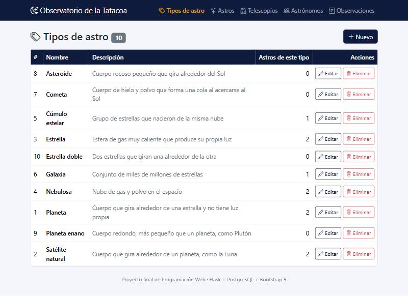

**CP-02 · Crear**


**CP-03 · Datos inválidos**

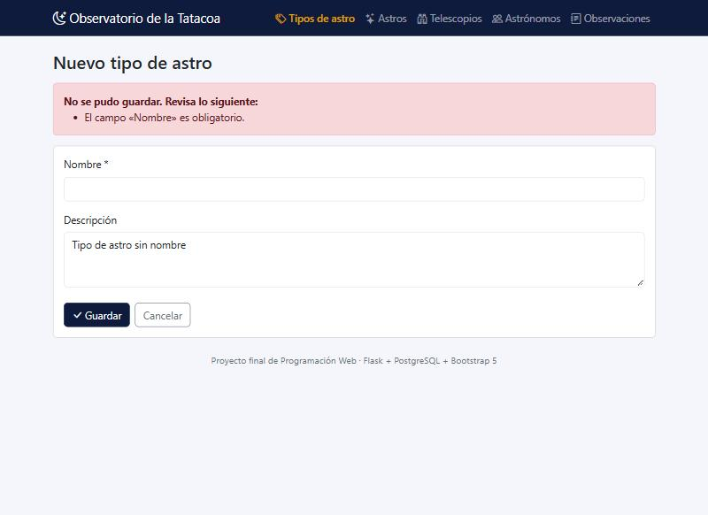

**CP-04 · Valor duplicado**

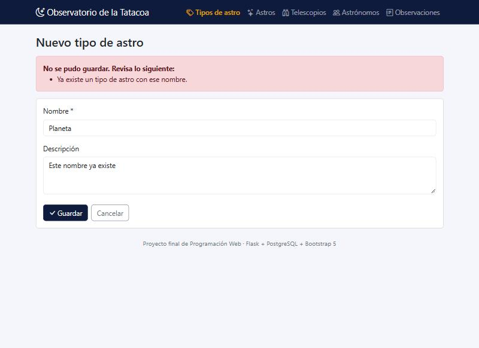

**CP-05 · Editar** — (a) formulario precargado, (b) resultado

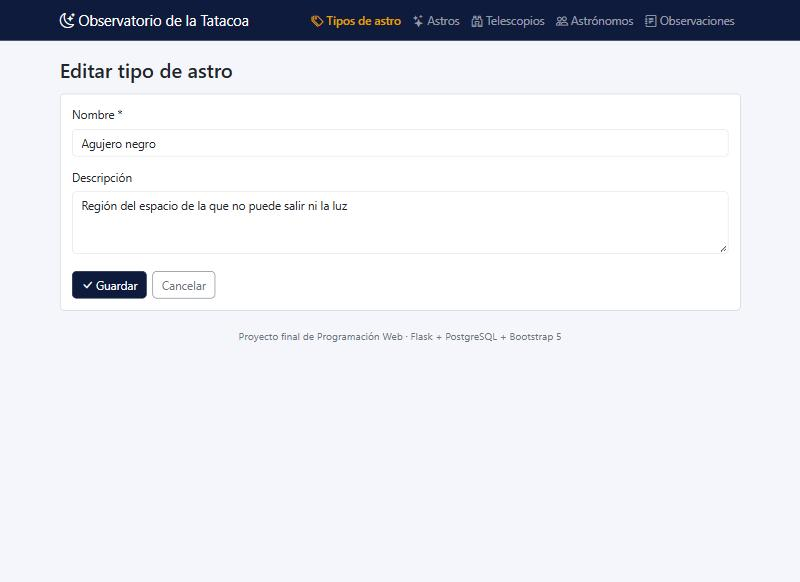


**CP-06 · Eliminar** — (a) confirmación previa, (b) resultado

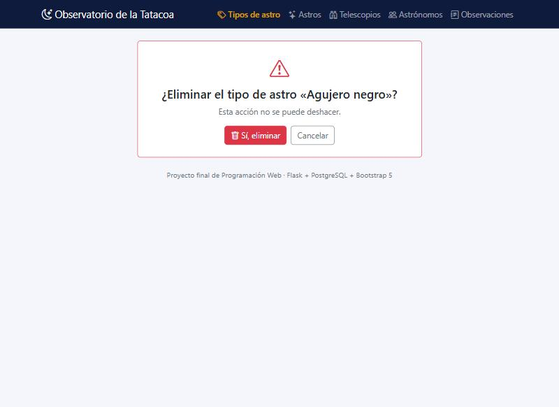

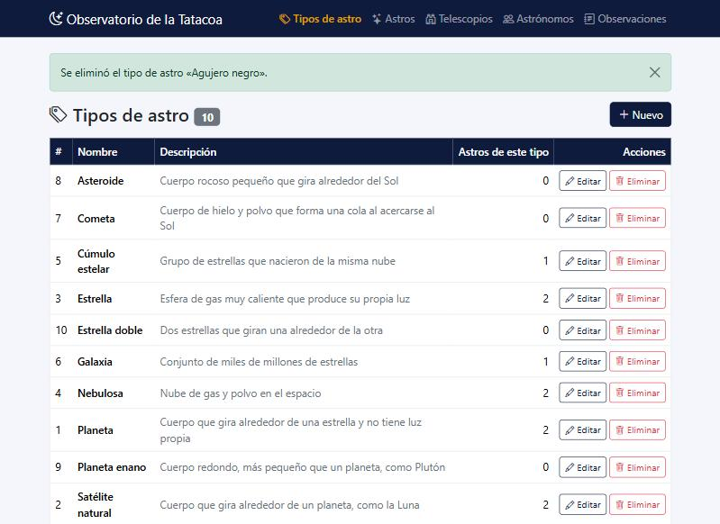

**CP-07 · Eliminar relacionado**

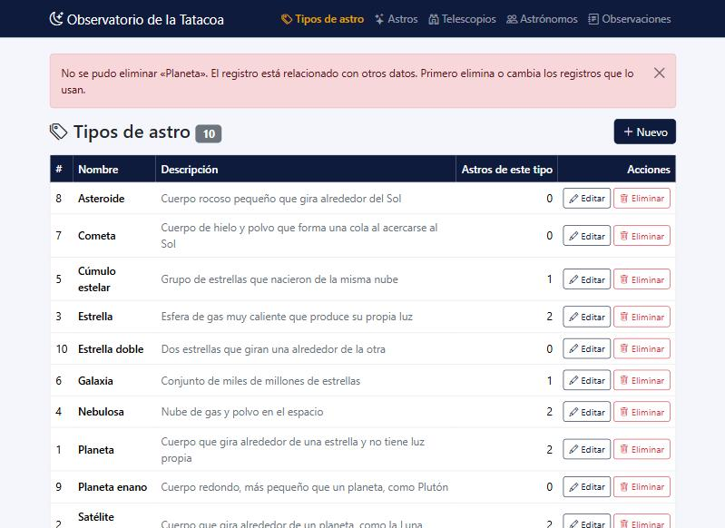

**CP-08 · Crear (inyección SQL)**

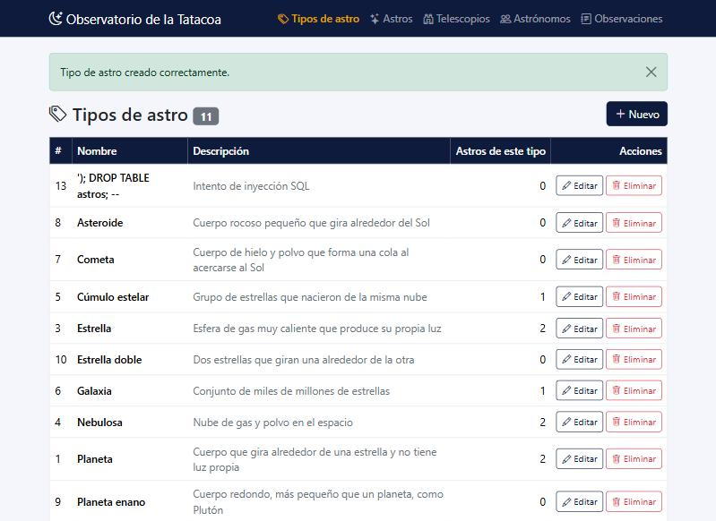

---

## 4. Tabla `astros`

| ID | Tabla | Operación | Datos de entrada | Resultado esperado | Resultado obtenido |
|---|---|---|---|---|---|
| CP-09 | astros | Listar | Abrir «Astros» en el menú | Tabla con los 10 astros. La columna «Tipo de astro» muestra el **nombre** del tipo, no su id | Cumple ✓ |
| CP-10 | astros | Crear | Nombre: `Marte` · Tipo de astro: `Planeta` (lista desplegable) · Casilla «a simple vista» marcada | Se guarda, aparece en el listado con el tipo `Planeta` y muestra «Astro creado correctamente.» | Cumple ✓ |
| CP-11 | astros | Datos inválidos | Nombre vacío · Tipo sin elegir · Constelación: `Orión` | No se guarda. Mensajes «El campo «Nombre» es obligatorio.» y «Debes elegir una opción en «Tipo de astro».» | Cumple ✓ |
| CP-12 | astros | Valor duplicado | Nombre: `Júpiter` (ya existe) · Tipo: `Planeta` | No se guarda. Mensaje «Ya existe un astro con ese nombre.» | Cumple ✓ |
| CP-13 | astros | Editar | «Editar» en `Marte` y cambiar el nombre a `Marte (el planeta rojo)` | El formulario llega precargado, con el tipo `Planeta` ya elegido. Al guardar muestra «Astro actualizado correctamente.» | Cumple ✓ |
| CP-14 | astros | Eliminar | «Eliminar» en `Marte (el planeta rojo)` (no tiene observaciones) y luego «Sí, eliminar» | Primero pide confirmación. Luego elimina y muestra «Se eliminó el astro «Marte (el planeta rojo)».» | Cumple ✓ |
| CP-15 | astros | Eliminar relacionado | «Eliminar» en `Júpiter` (tiene 2 observaciones) y luego «Sí, eliminar» | No se elimina. Mensaje «No se pudo eliminar «Júpiter». El registro está relacionado con otros datos…» | Cumple ✓ |

### Evidencias

**CP-09 · Listar**

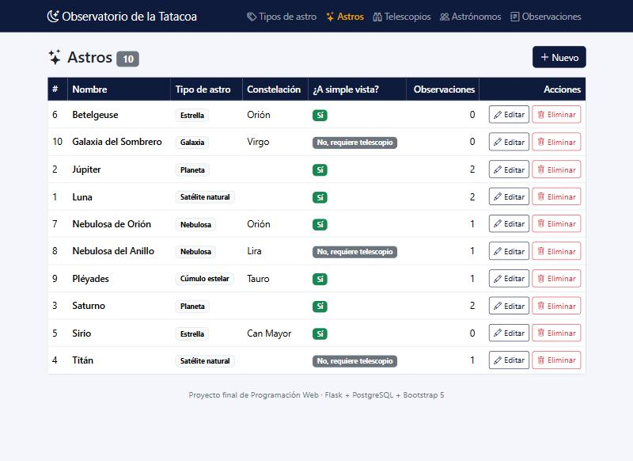

**CP-10 · Crear** — (a) formulario con la lista desplegable, (b) resultado

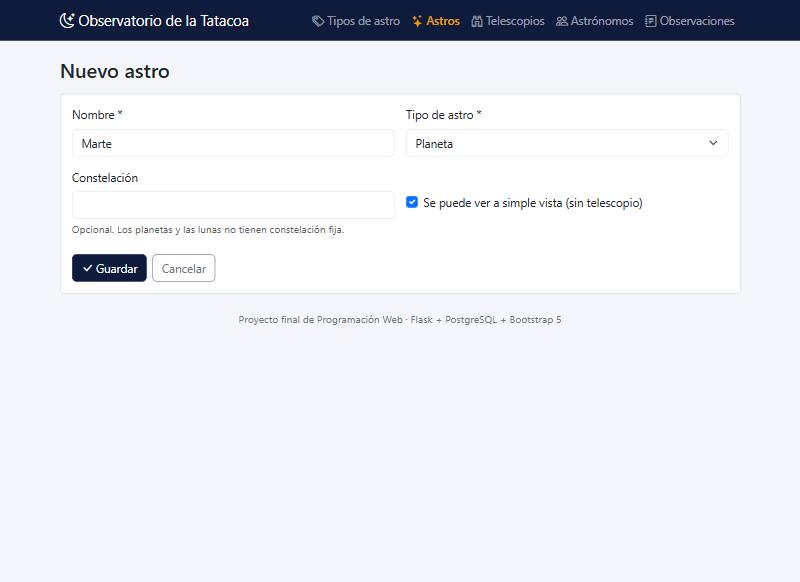

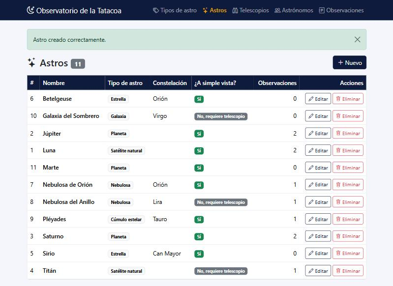

**CP-11 · Datos inválidos**

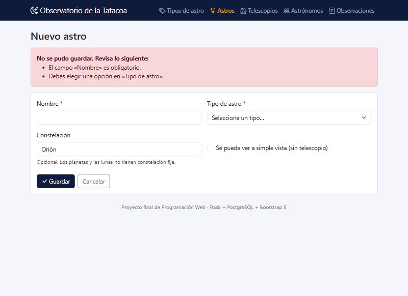

**CP-12 · Valor duplicado**

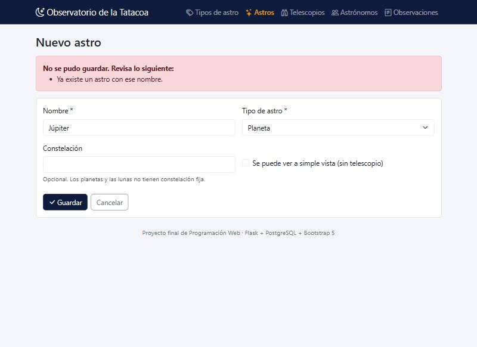

**CP-13 · Editar** — (a) formulario precargado, (b) resultado


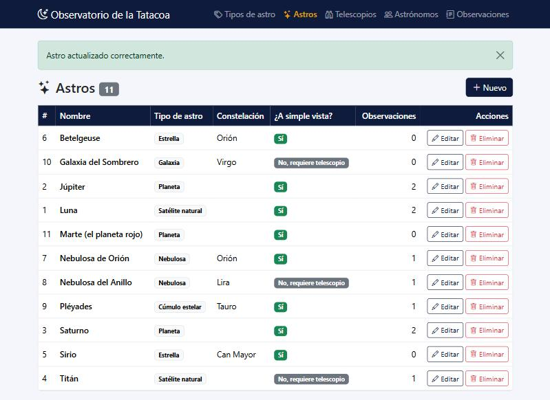

**CP-14 · Eliminar** — (a) confirmación previa, (b) resultado

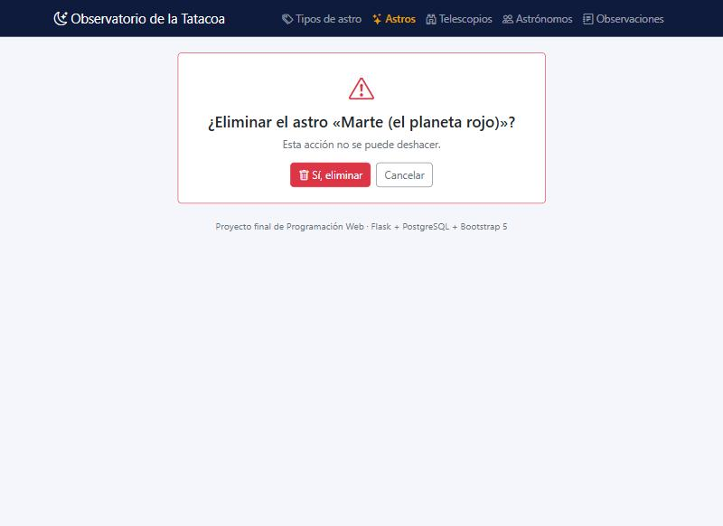

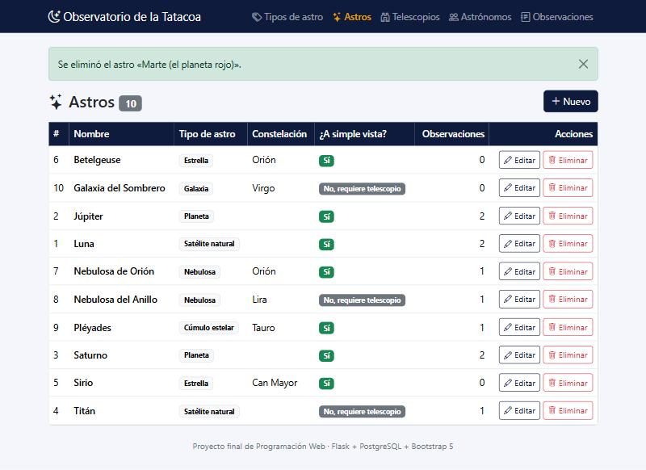

**CP-15 · Eliminar relacionado**

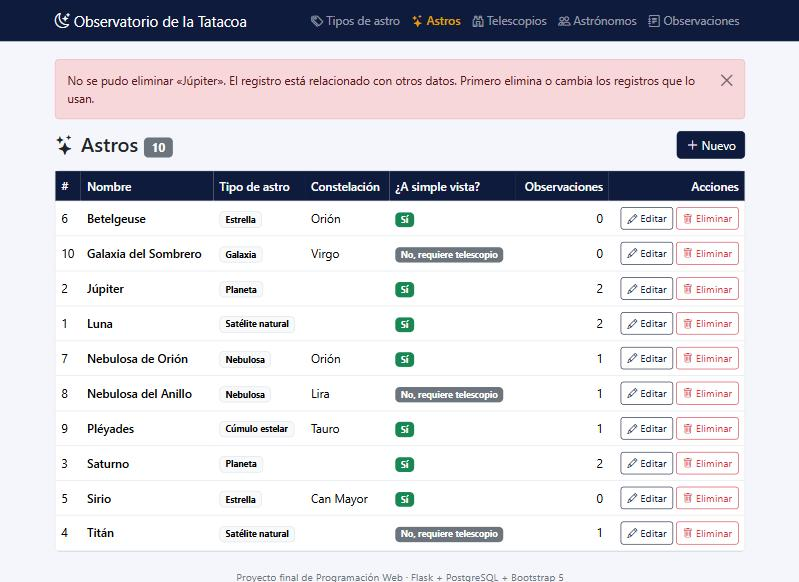

---

## 5. Tabla `telescopios`

| ID | Tabla | Operación | Datos de entrada | Resultado esperado | Resultado obtenido |
|---|---|---|---|---|---|
| CP-16 | telescopios | Listar | Abrir «Telescopios» en el menú | Tabla con los 10 telescopios y sus observaciones | Cumple ✓ |
| CP-17 | telescopios | Crear | Código: `TEL-11` · Marca y modelo: `Celestron Inspire 100AZ` · Tipo: `Refractor` · Apertura: `100` | Se guarda, aparece en el listado y muestra «Telescopio creado correctamente.» | Cumple ✓ |
| CP-18 | telescopios | Datos inválidos | Código: `TEL-99` · Tipo sin elegir · Apertura: `0` | No se guarda. Mensajes «Debes elegir una opción en «Tipo».» y «El campo «Apertura (mm)» debe ser mayor o igual a 1.» | Cumple ✓ |
| CP-19 | telescopios | Valor duplicado | Código: `TEL-01` (ya existe) | No se guarda. Mensaje «Ya existe un telescopio con ese código.» | Cumple ✓ |
| CP-20 | telescopios | Editar | «Editar» en `TEL-11` y cambiar la apertura de `100` a `102` | El formulario llega precargado. Al guardar muestra «Telescopio actualizado correctamente.» | Cumple ✓ |
| CP-21 | telescopios | Eliminar | «Eliminar» en `TEL-11` (no tiene observaciones) y luego «Sí, eliminar» | Primero pide confirmación. Luego elimina y muestra «Se eliminó el telescopio «TEL-11».» | Cumple ✓ |
| CP-22 | telescopios | Eliminar relacionado | «Eliminar» en `TEL-01` (tiene 3 observaciones) y luego «Sí, eliminar» | No se elimina. Mensaje «No se pudo eliminar «TEL-01». El registro está relacionado con otros datos…» | Cumple ✓ |

### Evidencias

**CP-16 · Listar**

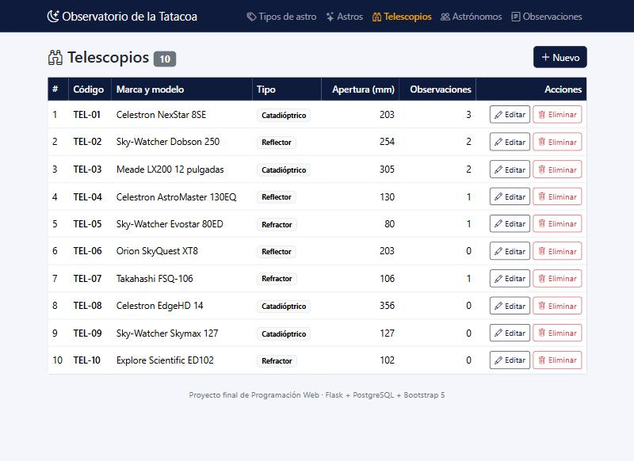

**CP-17 · Crear**


**CP-18 · Datos inválidos**

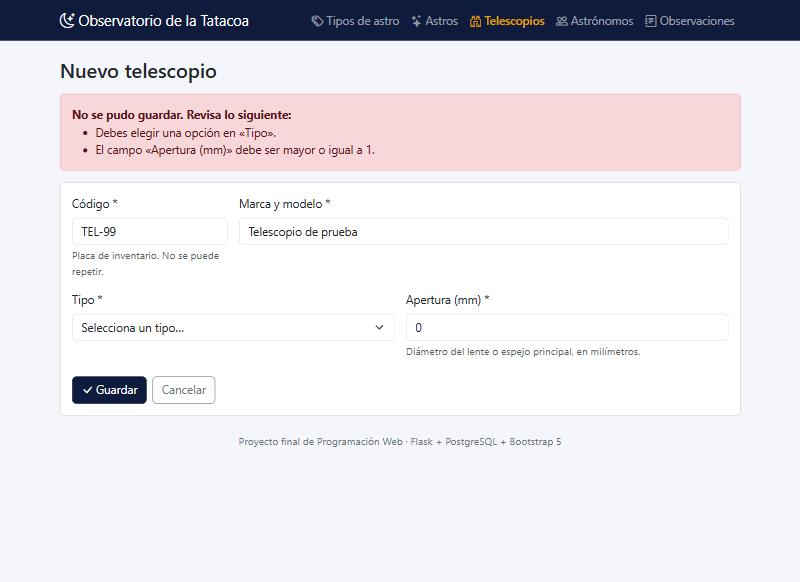

**CP-19 · Valor duplicado**

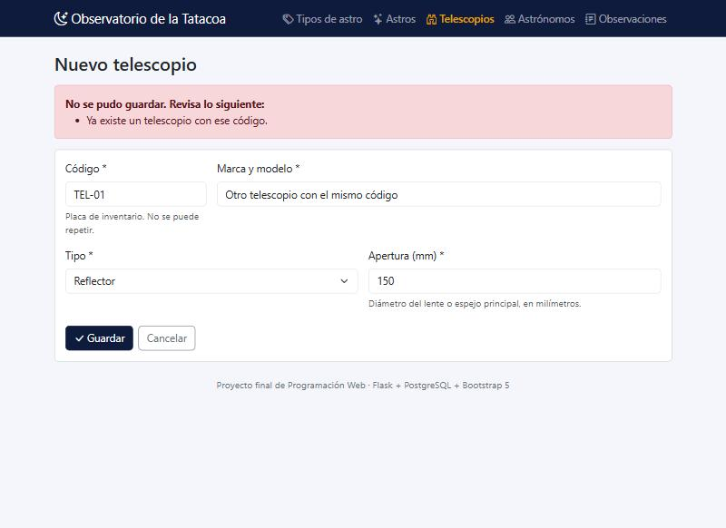

**CP-20 · Editar** — (a) formulario precargado, (b) resultado

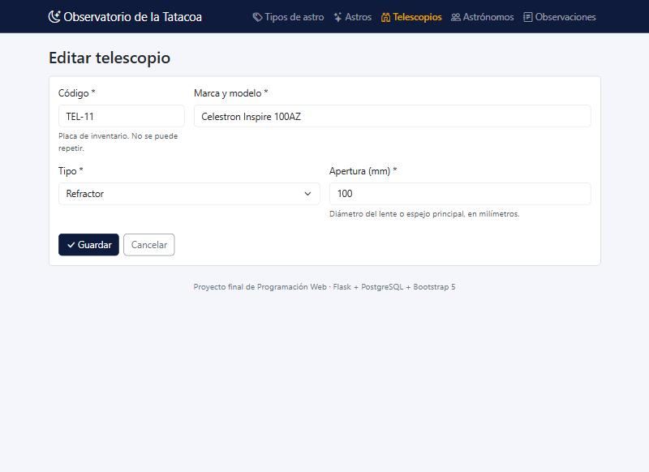

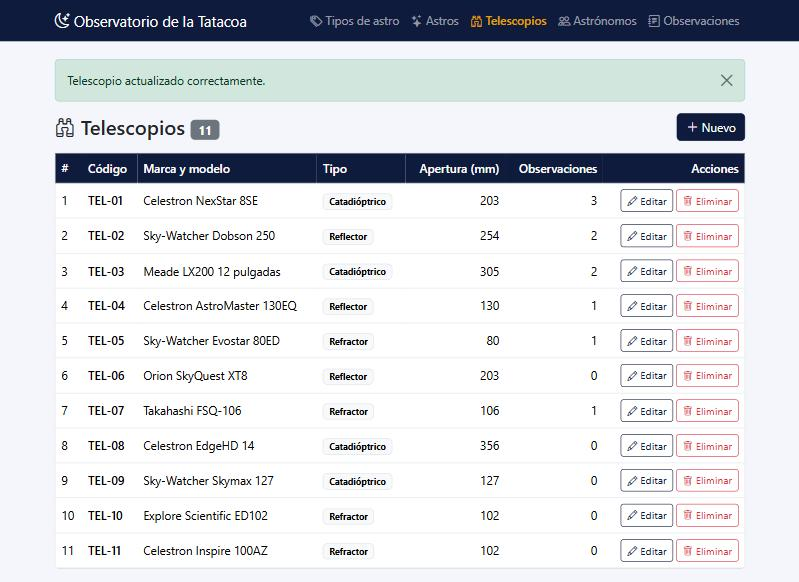

**CP-21 · Eliminar** — (a) confirmación previa, (b) resultado

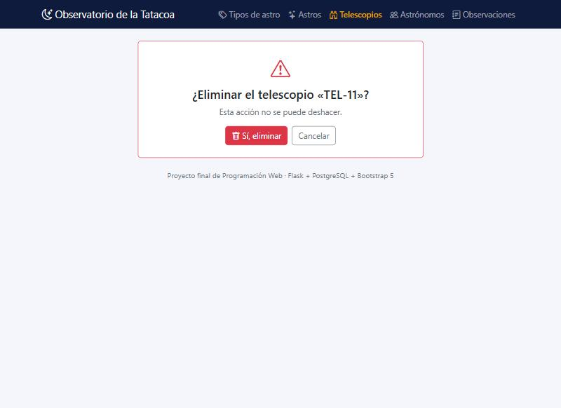

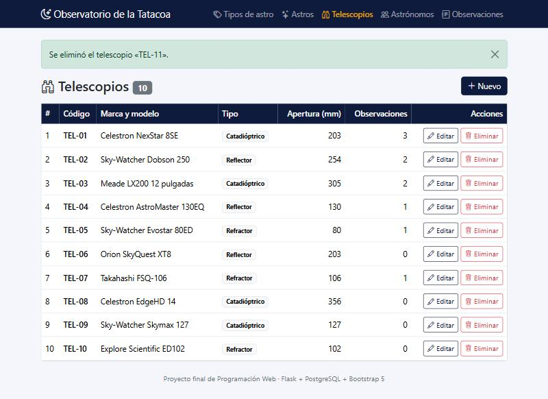

**CP-22 · Eliminar relacionado**

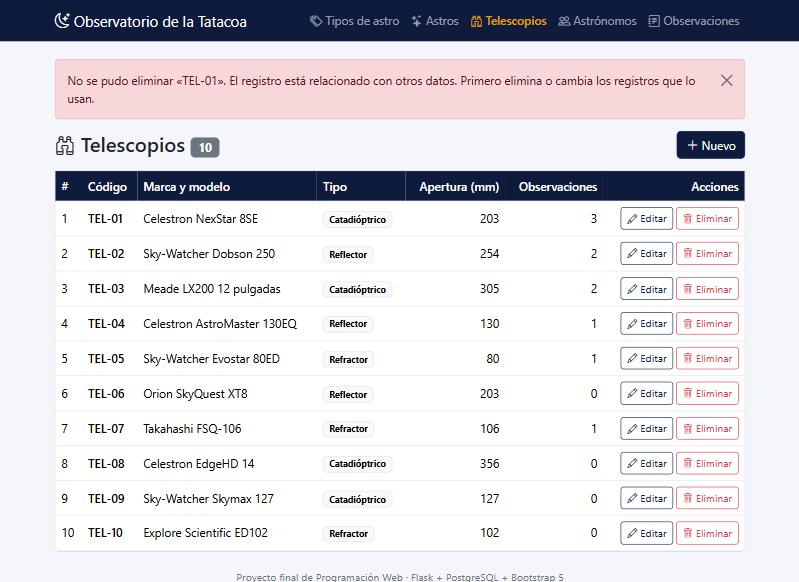

---

## 6. Tabla `astronomos`

| ID | Tabla | Operación | Datos de entrada | Resultado esperado | Resultado obtenido |
|---|---|---|---|---|---|
| CP-23 | astronomos | Listar | Abrir «Astrónomos» en el menú | Tabla con los 10 astrónomos y sus observaciones | Cumple ✓ |
| CP-24 | astronomos | Crear | Documento: `1083456789` · Nombre: `Laura Sofía Ramírez` · Correo: `laura.ramirez@example.com` | Se guarda, aparece en el listado y muestra «Astrónomo creado correctamente.» | Cumple ✓ |
| CP-25 | astronomos | Datos inválidos | Documento: `ABC-123` · Correo: `correo-sin-arroba` | No se guarda. Mensajes sobre el documento («solo puede tener números») y el correo («no parece un correo válido») | Cumple ✓ |
| CP-26 | astronomos | Valor duplicado | Documento: `1075234567` (ya es de otro astrónomo) | No se guarda. Mensaje «Ya existe un astrónomo con ese documento.» | Cumple ✓ |
| CP-27 | astronomos | Editar | «Editar» en `Laura Sofía Ramírez` y cambiar el correo a `laura.sofia@example.com` | El formulario llega precargado. Al guardar muestra «Astrónomo actualizado correctamente.» | Cumple ✓ |
| CP-28 | astronomos | Eliminar | «Eliminar» en `Laura Sofía Ramírez` (no tiene observaciones) y luego «Sí, eliminar» | Primero pide confirmación. Luego elimina y muestra «Se eliminó al astrónomo «Laura Sofía Ramírez».» | Cumple ✓ |
| CP-29 | astronomos | Eliminar relacionado | «Eliminar» en `Valentina Rojas Perdomo` (tiene 2 observaciones) y luego «Sí, eliminar» | No se elimina. Mensaje «No se pudo eliminar a «Valentina Rojas Perdomo». El registro está relacionado con otros datos…» | Cumple ✓ |

### Evidencias

**CP-23 · Listar**

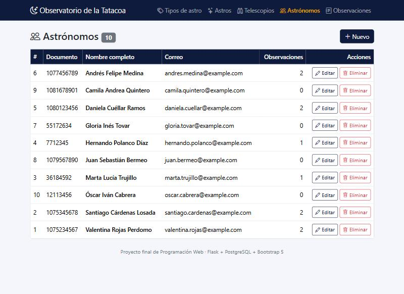

**CP-24 · Crear**

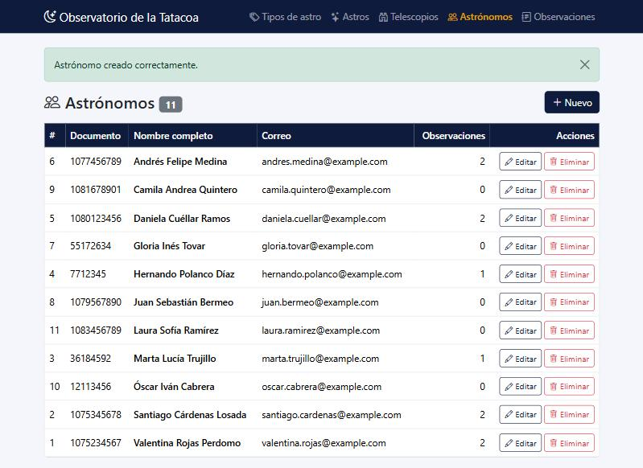

**CP-25 · Datos inválidos**

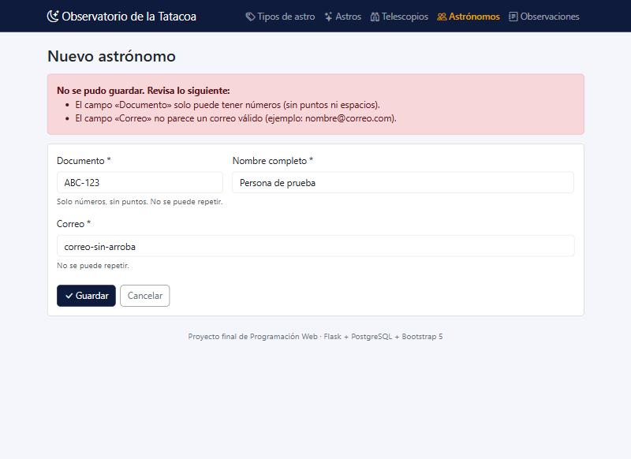

**CP-26 · Valor duplicado**

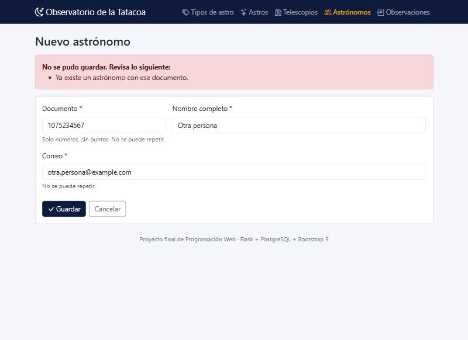

**CP-27 · Editar** — (a) formulario precargado, (b) resultado

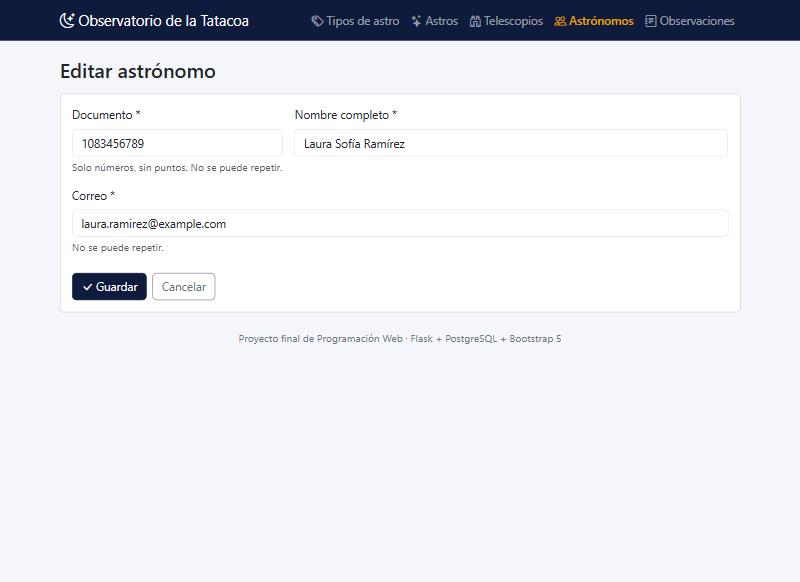


**CP-28 · Eliminar** — (a) confirmación previa, (b) resultado

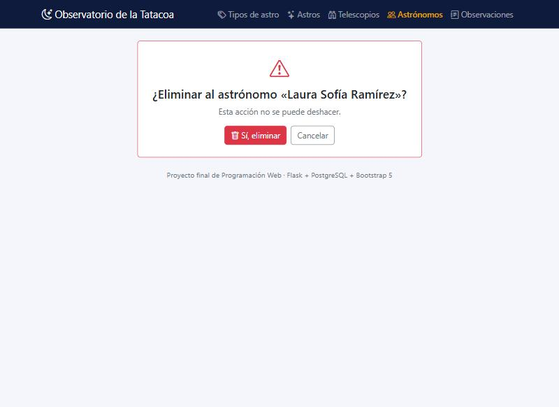

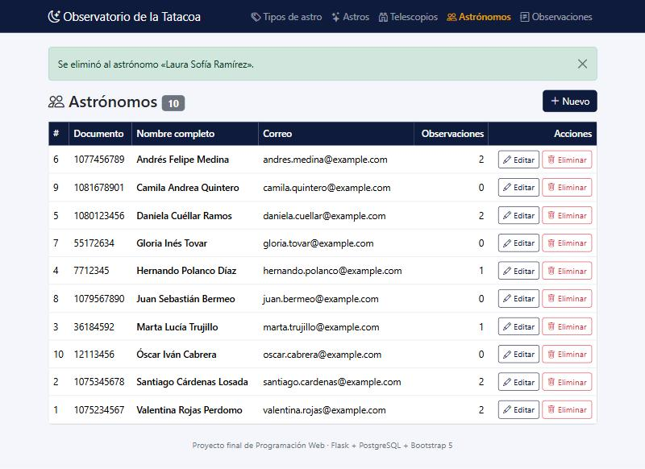

**CP-29 · Eliminar relacionado**

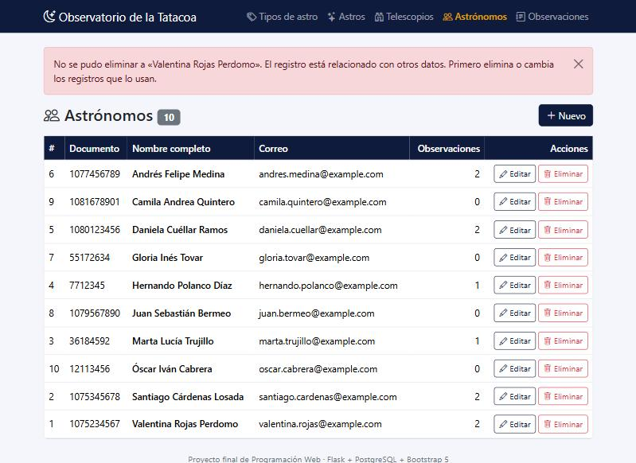

---

## 7. Tabla `observaciones`

| ID | Tabla | Operación | Datos de entrada | Resultado esperado | Resultado obtenido |
|---|---|---|---|---|---|
| CP-30 | observaciones | Listar | Abrir «Observaciones» en el menú | Tabla con las 10 observaciones. Muestra los **nombres** del astrónomo, del telescopio y del astro, no sus id | Cumple ✓ |
| CP-31 | observaciones | Crear | Fecha: `15/11/2026` · Astrónomo: `Gloria Inés Tovar` · Telescopio: `TEL-06` · Astro: `Sirio` (las tres, en listas desplegables) · Duración: `30` · Calidad: `4` | Se guarda, aparece de primera en el listado y muestra «Observación registrada correctamente.» | Cumple ✓ |
| CP-32 | observaciones | Datos inválidos (valores) | Fecha: `01/01/2030` (futura) · Duración: `0` · Calidad sin elegir | No se guarda. Mensajes: la fecha no puede ser futura, la duración debe ser mayor o igual a 1 y la calidad es obligatoria | Cumple ✓ |
| CP-33 | observaciones | Datos inválidos (llaves foráneas) | Astrónomo, telescopio y astro sin elegir | No se guarda. Tres mensajes «Debes elegir una opción en…», uno por cada lista desplegable | Cumple ✓ |
| CP-34 | observaciones | Editar | «Editar» en la observación creada y cambiar la calidad de `4` a `5` | El formulario llega precargado, con las tres listas en la opción guardada. Al guardar muestra «Observación actualizada correctamente.» | Cumple ✓ |
| CP-35 | observaciones | Eliminar | «Eliminar» en la observación creada y luego «Sí, eliminar» | Primero pide confirmación. Luego elimina y muestra «Se eliminó la observación número 11.» | Cumple ✓ |

### Evidencias

**CP-30 · Listar**

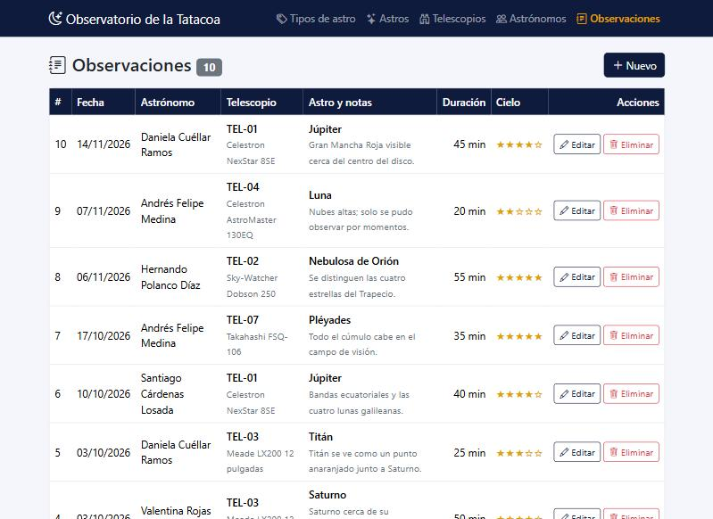

**CP-31 · Crear** — (a) formulario con las tres listas desplegables, (b) resultado

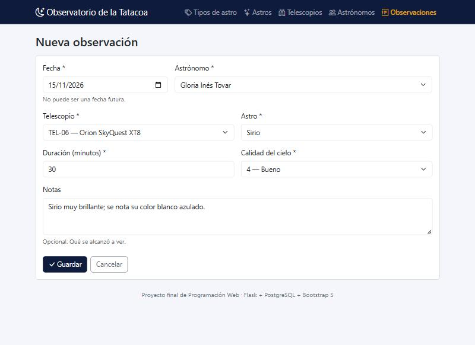

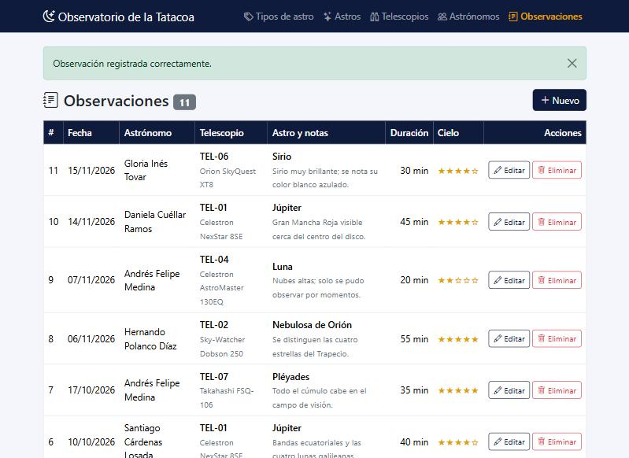

**CP-32 · Datos inválidos (valores)**

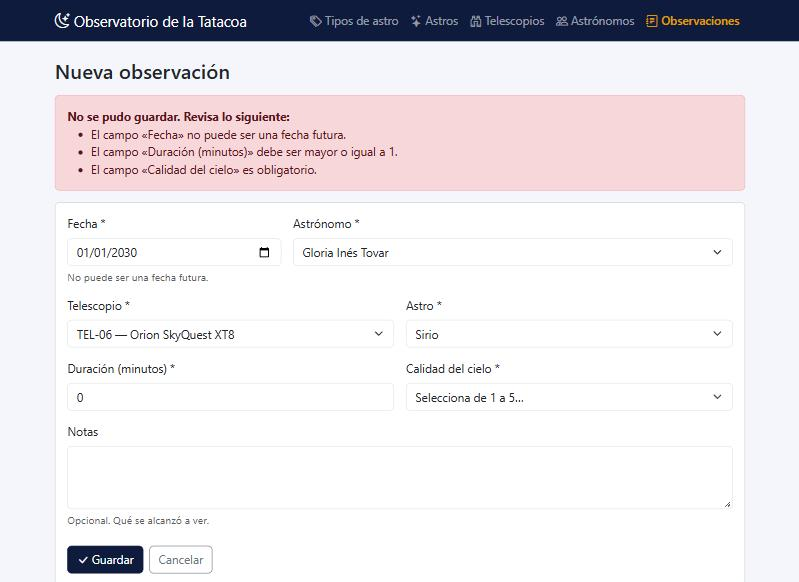

**CP-33 · Datos inválidos (llaves foráneas)**

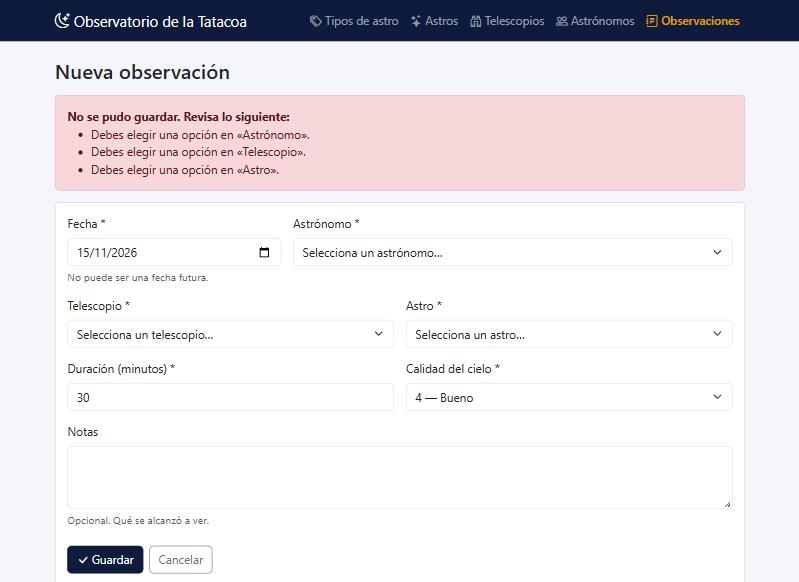

**CP-34 · Editar** — (a) formulario precargado, (b) resultado


**CP-35 · Eliminar** — (a) confirmación previa, (b) resultado

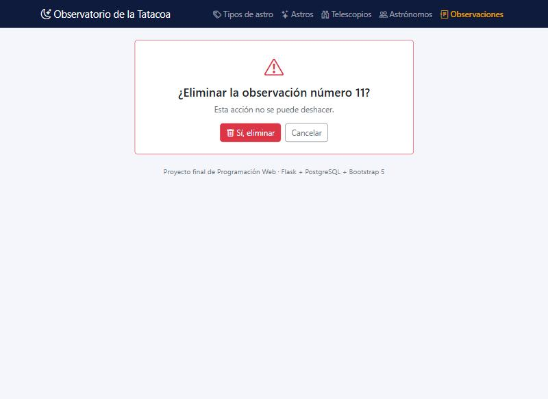

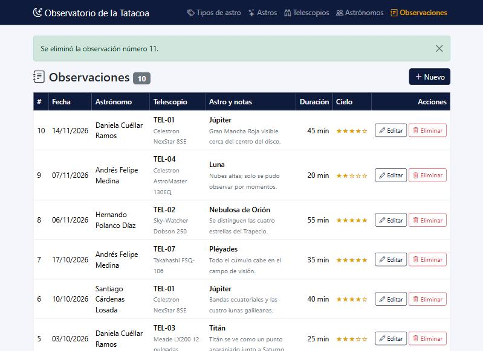

---

## 8. Pruebas automáticas con pytest (valor agregado)

Los 35 casos de este plan también están escritos como pruebas automáticas en la carpeta [`tests/`](../tests). Cada prueba lleva el código de su caso: por ejemplo, el caso **CP-07** es la función `test_cp07_eliminar_relacionado` de `tests/test_tipos_astro.py`.

| Archivo | Casos que cubre |
|---|---|
| `tests/test_tipos_astro.py` | CP-01 a CP-08 |
| `tests/test_astros.py` | CP-09 a CP-15 |
| `tests/test_telescopios.py` | CP-16 a CP-22 |
| `tests/test_astronomos.py` | CP-23 a CP-29 |
| `tests/test_observaciones.py` | CP-30 a CP-35 |
| `tests/test_general.py` | 12 pruebas extra: inicio, páginas 404 y que todas las páginas abran |

**Las pruebas no tocan los datos reales.** Usan una base de datos aparte (`observatorio_tatacoa_test`) que se crea de cero cada vez, con los mismos scripts de `database/`.

Algunas pruebas automáticas van un poco más allá que el caso del plan. CP-19 repite el código en minúsculas (`tel-01`), para comprobar que cuenta como el mismo `TEL-01`. CP-32 envía una calidad del cielo de `9` y CP-33 el id de un astro que no existe: son datos que el formulario no deja elegir, pero que alguien podría enviar por otro medio.

Para ejecutarlas, con el entorno virtual activado:

```
pytest
```

Resultado obtenido el 20 de noviembre de 2026:

```
platform win32 -- Python 3.14.10, pytest-9.2.0, pluggy-1.7.0
configfile: pytest.ini
testpaths: tests
collected 47 items

tests\test_astronomos.py .......                                         [ 14%]
tests\test_astros.py .......                                             [ 29%]
tests\test_general.py ............                                       [ 55%]
tests\test_observaciones.py ......                                       [ 68%]
tests\test_telescopios.py .......                                        [ 82%]
tests\test_tipos_astro.py ........                                       [100%]

============================= 47 passed in 9.68s ==============================
```
